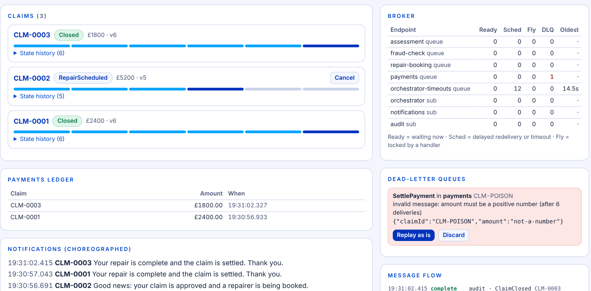

# Event-driven distributed systems: the demo

A runnable version of the workshop's reference architecture: a motor-claim process coordinated by a
state machine, services that talk only through a broker, and a dashboard where you can break things
on purpose. It exists to make the slides *visible*: queue depths move, a message gets redelivered, a
claim sticks, an outbox row saves the day.

```
npm install        # only TypeScript + Node types, for the typecheck. Nothing is needed at runtime.
npm start          # http://localhost:3000
npm test           # 35 tests: one or more per box on the slides, Round 2 cards A to F included
npm run typecheck
```

Needs **Node 22.18+** (it runs the TypeScript directly and uses the built-in `node:sqlite`). No Docker,
no broker to install, no build step.



## What you are looking at

```
 intake API ──ClaimSubmitted──▶ [ claim-events topic ] ──▶ sub: orchestrator ──▶ ┐
                                       ▲    │  │                                 │  Claim orchestrator
                                       │    │  └──▶ sub: notifications           │  (state machine, own DB:
   services publish outcome events ────┘    └─────▶ sub: audit                   │   state + version + outbox)
                                                                                  │
   [ assessment ] [ fraud-check ] [ repair-booking ] [ payments ] ◀── commands ──┘
        queues (each with a DLQ) feeding the services that own those capabilities
```

Every arrow goes through the broker. Nothing calls anything directly. The dashboard is a *query*
(HTTP reads of the orchestrator's state history and the broker's stats); it never goes over the bus.

## Slide to code

| Slide | Where to look |
|---|---|
| **Three kinds of message** (7) | `src/messages.ts`: commands are imperative and go to a queue; events are past tense and go to the topic |
| **One model, two brokers** (8), **Topology** (9) | `src/broker.ts`: topics, filtered subscriptions, queues, DLQ per endpoint, scheduled delivery, in Service Bus vocabulary. `src/system.ts` wires the topology |
| **Plan for at-least-once** (10) | `broker.ts` peek-lock: a message is removed only on `complete()`. Lock expiry and a lost ack both cause redelivery. `consume()` in `src/runtime.ts` acks *after* the handler finishes |
| **The reference architecture** (11) | `src/system.ts` |
| **The claim lifecycle** (12) | `src/orchestrator/machine.ts`, the header comment and `decide()` |
| **Anatomy of one transition** (13) | `src/orchestrator/orchestrator.ts` `handle()`: load + version, guard, transition and record in one transaction, messages leave via the outbox. `decide()` is a pure function: unit tests in `test/machine.test.ts` need no broker |
| **Orchestration or choreography?** (14) | Orchestrated: assessment, fraud, repair, payment. Choreographed: `Notifications` and `Audit` subscribe and decide for themselves |
| **Sagas** (15) | The `Cancelling` state and `CancelRepairBooking`. The compensation is a business operation, is retried, and is visible as a state |
| **The transactional outbox** (16) | `Outbox` in `src/runtime.ts`, used by the orchestrator, repair and payments. Inbox: `PaymentsService.settle` |
| **Idempotency, correlation, ordering** (17) | Inbox + natural key in payments; `ClaimId` as `correlationId` on every message; `version` check in the `UPDATE ... WHERE version = ?`; the `Assessing` join accepts either order |
| **Failure handling** (18) | `consume()`: immediate retry, delayed redelivery with backoff, DLQ. State timeouts in `onTimeout()`. Replay tool in the dashboard |
| **Observability** (19) | `history` table (every transition: from, to, event, time, note), message flow log, queue depth + oldest age + DLQ count on the dashboard |
| **Events are a public API** (20) | Event bodies carry the facts consumers need (`claimId`, plus `reason`, `state`), not database rows |

## Running the exercise

**Round 1 (model it):** keep `src/orchestrator/machine.ts` closed. Groups draw their own diagram, then
compare with the one here.

**Round 2 (break it):** the *Round 2: break it* panel has one control per card. Suggested demos, each
~2 minutes, and what the room should see:

| Card | Do this | What happens | Pattern |
|---|---|---|---|
| **A** duplicate event | *Duplicate next PaymentSettled*, submit a claim | The claim closes once; its history shows `ignored: claim already Closed` | Guard in the state machine |
| **A** (the sting) | Untick *Payments is idempotent*, *Duplicate next SettlePayment*, submit | **The ledger turns red: paid twice** | Idempotent consumers |
| **B** out of order | Tick *Slow assessment*, submit | `FraudCleared` lands first; the claim waits in `Assessing` (history note), then approves | A state that accepts both orders |
| **C** dependency down | Tick *Repair provider down*, submit, untick after ~5 s | `BookRepair` retries with backoff (watch *Sched*), then succeeds | Delayed redelivery |
| **C** (long outage) | Leave it down ~60 s (three 20 s deadlines) | DLQ fills, the state's timeout resends, then **needs a human** | DLQ + timeouts + escalation |
| **C** (ops view) | Untick it, press *Replay as is* on a dead letter | The claim recovers and the flag clears | Replay tool; idempotent booking |
| **D** poison message | *Inject poison message* | Retries, then a DLQ entry with the reason; other claims are unaffected | Bounded retries + DLQ |
| **E** crash before publish | *Crash orchestrator on next commit*, submit | With the outbox: a retry, then it carries on | Transactional outbox |
| **E** (the sting) | Untick *Transactional outbox*, crash, submit | **The claim sits in `Assessing` forever.** No error, no DLQ, no escalation | The dual-write problem |
| **F** cancel mid-booking | Tick *Slow repair booking*, submit, press **Cancel** while `Approved` | `Cancelling`: the cancel is recorded, the booking lands, the compensation runs, then `Cancelled` | Saga compensation |

The facilitator question from the slides works here too: *"what happens if that event never arrives?"*
Pause the room on the E (sting) claim and ask how they would have found out.

## How faithful is the broker?

`src/broker.ts` is a ~280 line in-memory implementation, chosen so the whole thing runs with `npm start`
and the semantics are readable in one sitting. It models what the workshop relies on:

- at-least-once delivery with peek-lock, delivery counts and lock expiry
- no global ordering (a redelivered message overtakes later ones)
- no duplicate detection: duplicates are the consumer's problem
- topics with per-subscription copies, filters, scheduled delivery, a DLQ on every endpoint

What it does **not** model: durability across a process restart (the broker and the demo databases are
in memory), network partitions, sessions, or competing consumers on one queue. `consume()`'s abandon-with-delay stands in for
Service Bus scheduled redelivery.

## Taking it to a real broker

The seam is small. `Broker` exposes `publish`, `send`, `consume`, and settle operations
(`complete`/`abandon`/`deadLetter`). To run on Azure Service Bus or RabbitMQ, implement those over the
client library; the orchestrator, services, outbox and tests do not change. Mapping, from slide 8:
`publish` → topic / exchange, `send` → queue, `abandon(delay)` → scheduled message / delayed-message
plugin, `deadLetter` → dead-letter sub-queue / dead-letter exchange.

In a .NET codebase, the same design maps onto MassTransit or NServiceBus sagas, outbox and inbox. This
demo hand-rolls them in TypeScript so each moving part is visible rather than configured.

## Things that are simulated, on purpose

- The fraud analyst's verdict, and the garage finishing the repair, are `setTimeout`s inside the
  services. A real system would use a work queue and a webhook; those timers would not survive a restart.
- The `scenario` dropdowns on a claim (assessment passes or fails; fraud found or not) steer each
  claim down a particular path so a room can see every branch. Real services would decide from the data.
- Everything runs in one process for the demo; the components only communicate through the broker, so
  they could be split without changing their code.
- Timings live in `src/config.ts`. `LIVE` is paced for a projector; `FAST` is the same behaviour
  compressed to milliseconds for the test suite.

## Layout

```
src/
  messages.ts              message envelope, queue/subscription names
  broker.ts                the in-memory broker
  runtime.ts               consumer retry ladder, transaction helper, transactional outbox
  config.ts                LIVE and FAST timings
  orchestrator/
    machine.ts             the pure state machine
    orchestrator.ts        the runtime loop around it
  services/services.ts     assessment, fraud, repair booking, payments, notifications, audit
  system.ts                wiring, fault switches, intake API, snapshot
  server.ts                dashboard + control API
public/index.html          the dashboard
test/                      machine.test.ts (pure) and scenarios.test.ts (rounds 1 and 2)
```
